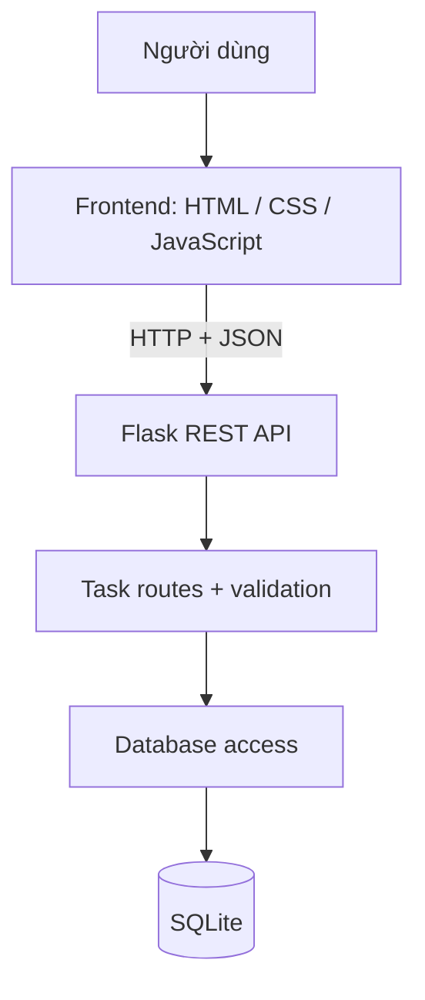

# Kiến trúc TaskFlow

## 1. Tổng quan

TaskFlow là ứng dụng web client-server đơn giản. Frontend thuần HTML/CSS/JavaScript gửi HTTP request đến REST API viết bằng Flask. Backend kiểm tra dữ liệu, thao tác SQLite bằng câu lệnh có tham số và trả JSON.

## 2. Sơ đồ thành phần

## 3. Cấu trúc backend

- `backend/app/__init__.py`: application factory, cấu hình Flask, đăng ký blueprint và error handlers.
- `backend/app/tasks.py`: REST endpoints, serialization và kiểm tra dữ liệu đầu vào.
- `backend/app/database.py`: quản lý kết nối SQLite theo application context.
- `backend/app/schema.sql`: bảng `tasks` và index.
- `backend/tests/`: kiểm thử API qua Flask test client và database tạm.

## 4. Luồng tạo công việc

1. Người dùng nhập tiêu đề/mô tả ở frontend.
2. JavaScript gửi `POST /api/tasks` với JSON.
3. Flask kiểm tra JSON object, trường hợp lệ, kiểu dữ liệu và giới hạn ký tự.
4. Backend lưu dữ liệu bằng parameterized SQL query.
5. API trả `201 Created` và đối tượng task.
6. Frontend tải lại danh sách để hiển thị dữ liệu mới.

## 5. Ranh giới và giới hạn kiến trúc

- Frontend được phục vụ cùng origin bởi Flask nên không cần cấu hình CORS cho cách chạy hiện tại.
- SQLite phù hợp với ứng dụng demo một người dùng, không nhắm đến tải ghi đồng thời lớn.
- Chưa có tầng xác thực, phân quyền, service/repository riêng vì nghiệp vụ còn nhỏ. Khi dự án mở rộng, có thể tách validation, service và data-access thành module độc lập.
- Dữ liệu hiện dùng một database cục bộ, chưa hỗ trợ nhiều tài khoản hoặc đồng bộ cloud.
