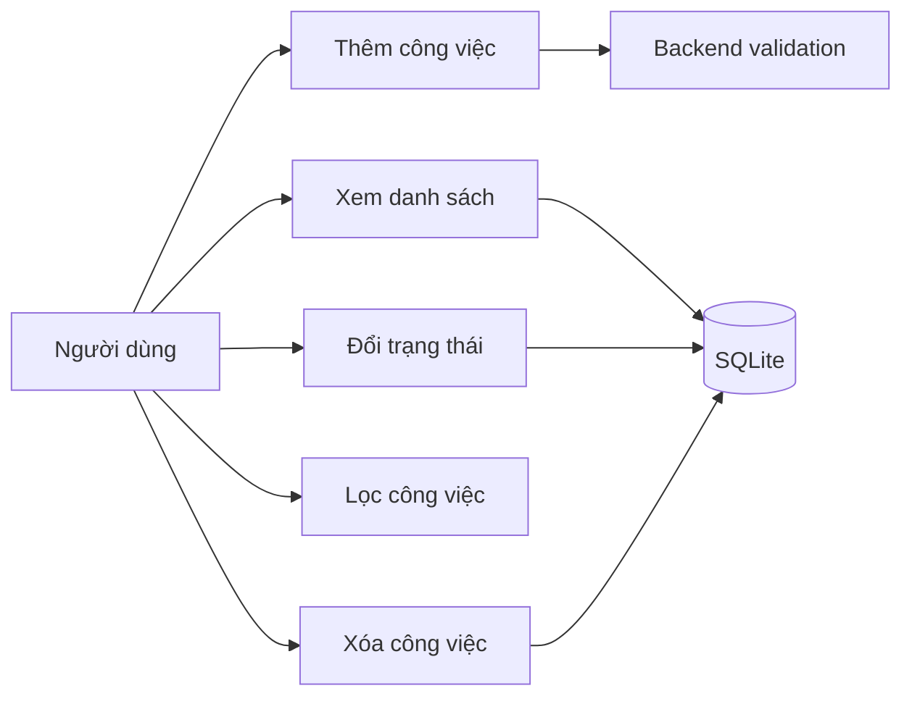

# Đặc tả ca sử dụng TaskFlow

## Tác nhân

Người dùng ứng dụng. Phiên bản hiện tại không yêu cầu đăng nhập.

## Danh sách ca sử dụng

| Mã | Ca sử dụng | Mô tả |
|---|---|---|
| UC-01 | Thêm công việc | Nhập tiêu đề và mô tả, lưu task mới |
| UC-02 | Xem công việc | Hiển thị danh sách task đã lưu |
| UC-03 | Đổi trạng thái | Đánh dấu task hoàn thành hoặc đang làm |
| UC-04 | Lọc công việc | Lọc theo tất cả, đang làm, hoàn thành |
| UC-05 | Xóa công việc | Xác nhận trước khi xóa task |

## Luồng chính: thêm công việc

1. Người dùng mở trang TaskFlow.
2. Nhập tiêu đề; mô tả có thể để trống.
3. Chọn nút thêm công việc.
4. Frontend gửi request đến `POST /api/tasks`.
5. Backend kiểm tra dữ liệu. Nếu hợp lệ, lưu vào SQLite.
6. Frontend tải lại danh sách và hiển thị task mới.

## Luồng ngoại lệ

- Tiêu đề rỗng hoặc chỉ có khoảng trắng: backend trả `400` và hiển thị thông báo.
- Tiêu đề/mô tả vượt giới hạn: backend từ chối request.
- API không truy cập được: giao diện hiển thị lỗi thay vì giả định thao tác thành công.
- Xóa task: người dùng có thể hủy tại hộp thoại xác nhận.

## Sơ đồ use case

